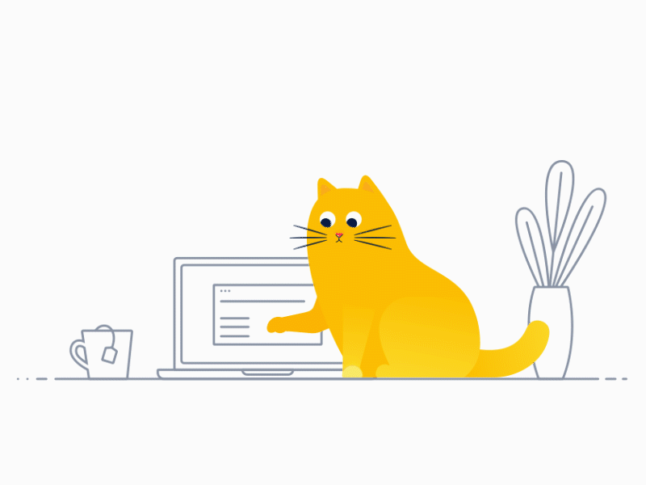

<!-- ==================== HEADER SECTION ==================== -->

  

  

<!-- Quick Action Badges -->

  
  
  
  

 

<!-- ==================== ABOUT ME SECTION ==================== -->
<table>
  <tr>
    <td width="48%" align="center" valign="middle">
      
    </td>
    <td width="52%" valign="middle">
      <h3> About Me</h3>
      

        Hi! I'm <strong>Joram Kate Leonardo</strong>, a passionate <strong>Full Stack Web Developer</strong> with <strong>6+ years of experience</strong> engineering, deploying, and maintaining high-concurrency, database-driven information systems.
      

      <ul>
        <li>💼 <strong>Primary Tech:</strong> Laravel 12 & Inertia.js v2 paired with React 19 / Vue 3</li>
        <li>🐍 <strong>Data Stack:</strong> Python 3.12 (Django 6, Pandas, Matplotlib, ReportLab)</li>
        <li>⚡ <strong>Architecture:</strong> Concurrency-safe systems, pessimistic locking, & polymorphic audit trails</li>
        <li>📍 <strong>Location:</strong> Cavite, Philippines</li>
        <li>☕ <strong>Fuel:</strong> Coffee, clean code, and solving complex logic</li>
      </ul>
    </td>
  </tr>
</table>

 

<!-- ==================== TECH STACK SECTION ==================== -->
##  Technologies & Tools

### 🎨 Frontend Ecosystem

  
  
  
  
  
  
  
  
  
  
  

### ⚙️ Backend & API Architecture

  
  
  
  
  
  

### 🗄️ Database & Data Analytics

  
  
  
  
  
  

### 🧪 Testing & Quality Assurance

  
  
  
  

### 🛠️ Developer Ecosystem & Tools

  
  
  
  
  
  
  

<!-- ==================== GITHUB ANALYTICS SECTION ==================== -->
##  GitHub Analytics & Activity

  
  

  

  

  
  

<!-- ==================== CURRENT FOCUS SECTION ==================== -->
##  Current Focus & Architecture

<table>
  <tr>
    <td width="50%">
      <h4>⚡ Modern Full Stack SPAs</h4>
      

        Building high-performance monoliths and SPA-like applications with <strong>Laravel 12</strong>, <strong>Inertia.js v2</strong>, and <strong>React 19 / Vue 3</strong> with zero client-side API boilerplate.
      

    </td>
    <td width="50%">
      <h4>📊 Data Analytics & Reporting Pipelines</h4>
      

        Engineering automated executive reporting engines using <strong>Python 3.12 (Django 6, Pandas, Matplotlib)</strong> with dynamic PDF (ReportLab) & Excel generation.
      

    </td>
  </tr>
  <tr>
    <td width="50%">
      <h4>🔒 Relational Concurrency & Governance</h4>
      

        Protecting critical fiscal ledgers and transaction state with <strong>pessimistic locking</strong>, polymorphic audit trails, and multi-tier RBAC workflows.
      

    </td>
    <td width="50%">
      <h4>🧪 Test-Driven Reliability</h4>
      

        Ensuring regression-free and robust enterprise applications through automated end-to-end testing suites powered by <strong>Pest PHP</strong> and <strong>PHPUnit</strong>.
      

    </td>
  </tr>
</table>

 

<!-- ==================== CONTRIBUTION SNAKE ==================== -->
<h3 align="center">🐍 Contribution Graph Snake</h3>

  

<!-- ==================== FOOTER ==================== -->

  

<!-- ==================== FOOTER ==================== -->

  

